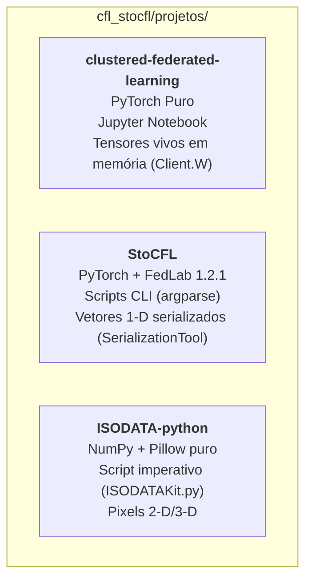
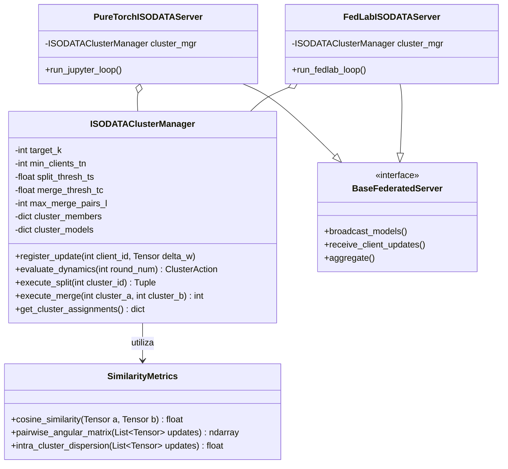

# Arquitetura de Software: Integração Modular dos Subprojetos

Este documento define o design arquitetural para implementação do framework **ISODATA-FL**, garantindo desacoplamento entre as regras do algoritmo de clusterização e os motores de treinamento federado existentes.

> **Status: proposta, nada implementado.** Os nomes de classes e métodos abaixo são ilustrativos. Antes de implementar, resolva os problemas em aberto da [especificação](especificacao-isodata-fl.md) (seção 5) e as decisões listadas na seção 5 deste documento.
>
> **Proposta mais recente:** o [plano modular](plano-isodata-fl/README.md) substitui, depois de aprovado, as duas integrações (`PureTorchISODATAServer` e `FedLabISODATAServer`) por um laço único ([módulo 8](plano-isodata-fl/08-arquitetura-do-codigo.md)) e o roteiro de 4 fases por um de 11 ([módulo 10](plano-isodata-fl/10-roteiro.md)).

---

## 1. Desafio de Integração entre Stacks Heterogêneas

Atualmente, o repositório contém três pilhas de software completamente distintas:

Se um agente tentar misturar o código do `ISODATA-python` diretamente dentro do notebook do CFL ou dentro dos scripts do FedLab sem uma camada de abstração, gerará acoplamento excessivo, dependências circulares e risco de corrupção do ambiente.

---

## 2. Arquitetura Alvo Proposta

A solução recomendada é criar um módulo agnóstico de clusterização (**`ISODATAClusterManager`**), que trata modelos e gradientes como tensores genéricos em $\mathbb{R}^D$, expondo métodos limpos para decisão de *Split* e *Merge*.

---

## 3. Especificação das Interfaces

### 3.1 `SimilarityMetrics`
Responsável por todos os cálculos geométricos no espaço de alta dimensão:
* `cosine_similarity(u, v)`: $\frac{\langle u, v \rangle}{\|u\| \|v\|}$.
* `pairwise_angular_matrix(updates)`: Matriz $N \times N$ com ângulos $\theta_{ij} = \arccos(S_{ij})$.
* `intra_cluster_dispersion(updates)`: Desvio angular médio $\sigma_{\theta}$ dos gradientes em relação à média do cluster.

### 3.2 `ISODATAClusterManager`
Mantém o estado dos clusters e aplica a lógica de Ball & Hall adaptada:
* **Entrada:** Identificadores dos clientes e seus tensores de atualização (`delta_w` ou $\psi$).
* **`evaluate_dynamics(round_num)`:** Avalia a paridade da rodada e os critérios de parada, retornando as ações a serem tomadas (`SPLIT`, `MERGE` ou `NONE`).
* **`execute_split(cluster_id)`:** Utiliza afinidade angular sobre os membros para biparticionar o grupo de clientes e duplicar os pesos do modelo.
* **`execute_merge(cluster_a, cluster_b)`:** Combina os membros e calcula o centroide ponderado dos pesos.

---

## 4. Roteiro de Implementação em Fases (Milestones)

1. **Fase 1 (Fundação e Métricas):**
   * Criar pacote utilitário `isodata_fl/` contendo `SimilarityMetrics` e testes unitários com vetores sintéticos.
2. **Fase 2 (Gerenciador de Clusters):**
   * Implementar `ISODATAClusterManager` independente de PyTorch/FedLab (apenas manipulando dicionários de listas e tensores NumPy/Torch).
3. **Fase 3 (Integração PyTorch Puro - CFL):**
   * Plugar o `ISODATAClusterManager` no loop do notebook `clustered_federated_learning.ipynb` ou script Python correspondente. Validar ganho de acurácia em EMNIST com rotações.
   * Pré-requisito: o notebook só suporta participação total (`frac=1.0`).
   * O cenário citado (EMNIST com rotação 180° em 5 de 10 clientes, 2 clusters reais) **não exercita o merge**: o CFL já separa os dois grupos. Para validar o merge é preciso um cenário com sobre-divisão (por exemplo, `EPS_2` baixo) em que a fusão possa corrigir o erro.
4. **Fase 4 (Integração FedLab - StoCFL):**
   * Adicionar flag `--algorithm isodata_fl` nos scripts CLI do StoCFL, permitindo fusão e divisão estocástica com participação parcial de clientes.
   * Estado atual: **a flag `--algorithm` não existe** nos scripts. O `StandaloneServer` está triplicado nos três scripts, e o guia (seção 6) recomenda refatorar antes de mudar o algoritmo.
   * O split quebra invariantes do StoCFL (guia 4.5); ver problema 7 da especificação.

---

## 5. Restrições do Ambiente e Decisões Pendentes

Verificado em 2026-11-04:

* O `.venv/` da raiz não tem `numpy`, `torch`, `scikit-learn` nem `fedlab` (README da raiz). O CFL e o StoCFL foram testados com Python 3.12, PyTorch 2.15 e `fedlab==1.2.1` ([guia, seção 4.11](../guia.md)).
* O repositório não tem testes automatizados. Só o StoCFL tem `requirements.txt`; o CFL não tem ([guia, seção 3.7 item 5](../guia.md)).
* **`BaseFederatedServer` não tem correspondente no código.** O `Server` do CFL (`fl_devices.py`), com pesos vivos em `client.W`, e o `StandaloneServer` do StoCFL, com vetores 1-D, têm estruturas bem diferentes. Uma classe base comum é uma hipótese de design, não algo que o código atual sustente. A alternativa mais simples, funções ou uma classe pura sobre vetores 1-D, não foi avaliada.

Decisões que o usuário ainda precisa tomar antes da implementação (política 4 do [CLAUDE.md](../../CLAUDE.md)):

1. Onde o pacote `isodata_fl/` ficará (novo subprojeto em `projetos/`, dentro de um dos existentes ou outro lugar). A [crítica](critica-documentacao-e-politicas.md), seção 2.2, já aponta essa lacuna.
2. Se a base do gerenciador de clusters é NumPy ou PyTorch.
3. Como reaproveitar a bipartição do CFL, que hoje é o Algoritmo 1 do artigo em `Server.cluster_clients`, sem dependências externas.
4. Qual algoritmo será o alvo primário: CFL, StoCFL ou ambos. O StoCFL já tem representação fixa (`ψ`) e participação parcial; o CFL assume participação total.
5. Todos os problemas em aberto da seção 5 da especificação.

