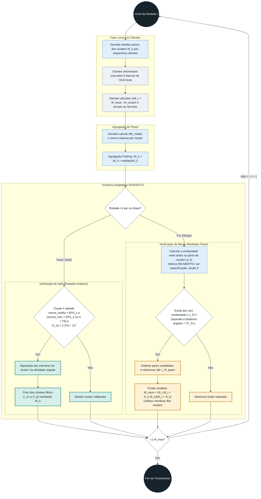
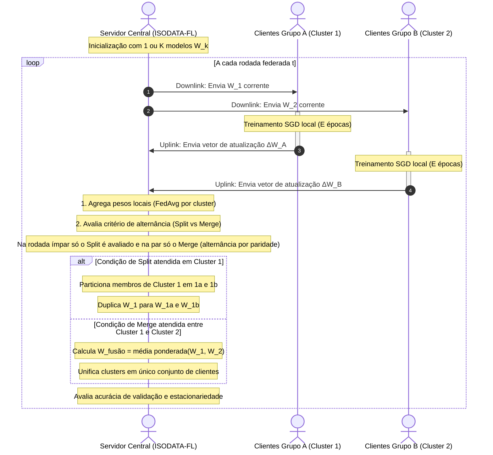

# Diagramas de Atividades e Sequência: Framework ISODATA-FL

Este documento apresenta os diagramas que descrevem o fluxo operacional e o protocolo de comunicação entre Servidor e Clientes para a execução do algoritmo híbrido **ISODATA-FL**.

> **Status: proposta, nada implementado.** Os diagramas seguem a [especificação](especificacao-isodata-fl.md) e herdam seus problemas em aberto (seção 5 dela), em especial a métrica do merge, o papel de $K_{\text{alvo}}$ e a participação parcial. Os diagramas devem ser revisados quando esses pontos forem decididos. Os diagramas do código existente estão em [`projetos/ISODATA-python/`](../../projetos/ISODATA-python/).
>
> **Diagramas mais recentes:** [plano modular, módulo 12](plano-isodata-fl/12-diagramas.md). Eles trocam a paridade por um calendário, acrescentam a verificação no merge e fazem o split **antes** da agregação, como o CFL do notebook. Os diagramas abaixo agregam antes de decidir o split, o que diverge do CFL.

---

## 1. Diagrama de Atividades: Ciclo de uma Rodada Federada

O diagrama abaixo detalha a lógica de decisão executada a cada rodada de comunicação federada, incorporando as etapas adaptativas de *Split* e *Merge*.

---

## 2. Diagrama de Sequência: Troca de Mensagens (Downlink / Uplink)

O diagrama a seguir exibe as interações de rede (simuladas) entre a entidade coordenadora (`Servidor`) e os dispositivos descentralizados (`Clientes`).

---

## 3. Invariantes e Regras de Estabilidade

Para evitar oscilações numéricas e divergências estocásticas durante o treinamento de redes neurais profundas, o agente implementador deve assegurar os seguintes invariantes:

1. **Histerese e Alternância Rígida:** Não executar *Split* e *Merge* na mesma rodada de comunicação. O `ISODATAKit.py` alterna por paridade da iteração, mas com exceções: split forçado quando $N \le K/2$ e merge forçado quando $N \ge 2K$. Esses desvios não estão nos diagramas acima (problema 2 da [especificação](especificacao-isodata-fl.md), seção 5).
2. **Período de Carência (*Warm-up*):** Não disparar operações de *Split* antes de um número mínimo de rodadas (valor ilustrativo, ex.: $t > 15$; o notebook do CFL usa 20 e `ε1`/`ε2` precisam ser calibrados junto, ver [guia, seção 3.5](../guia.md)). Clientes no início do treinamento possuem gradientes ruidosos com magnitude elevada que simulam falsas incongruências.
3. **Id do Cluster Normalizado:** Seguir a convenção do StoCFL, onde o identificador de um cluster unificado é sempre indexado pelo menor ID de cliente membro, preservando a coerência na serialização e nos logs.
4. **Invariantes do StoCFL a revisar:** o [guia, seção 4.5](../guia.md) estabelece que o número de clusters é não crescente e que `unite` só trata fusões. Um split viola o primeiro e exige tratar o id dos clusters filhos. Isso não está resolvido nos diagramas (problema 7 da especificação).

