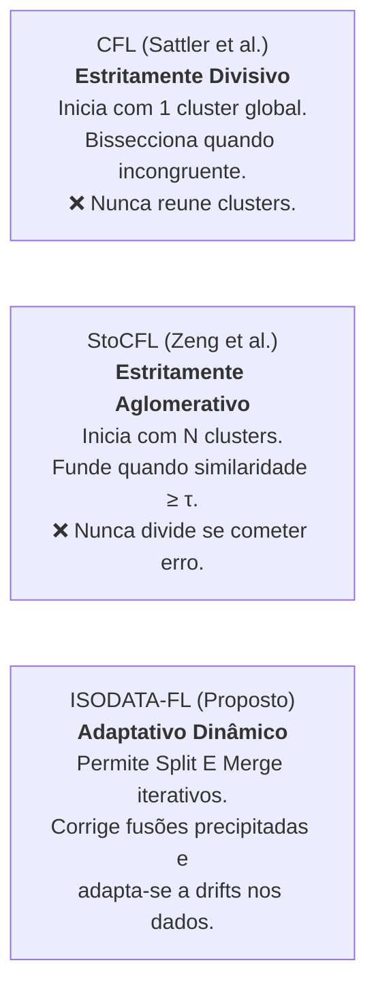

# Especificação Técnica e Matemática: ISODATA em Aprendizado Federado (ISODATA-FL)

Este documento especifica a formulação conceitual, matemática e algorítmica para transpor a dinâmica de agrupamento adaptativo do **ISODATA** para o contexto de **Aprendizado Federado Clusterizado (*Clustered Federated Learning*)**, unificando as vantagens do **CFL** (Sattler et al.) e do **StoCFL** (Zeng et al.).

> **Proposta mais recente:** o [plano modular](plano-isodata-fl/README.md) detalha esta ideia e encaminha os problemas da seção 5 ([mapa](plano-isodata-fl/11-decisoes-pendentes.md)). Onde divergirem, vale o plano, depois de aprovado. O plano recomenda, em particular, não usar o "ou $\sigma_{\theta,k} > TS_{FL}$" da seção 3.2 nem a direção média de $\Delta W$ citada no problema 1, e não sustenta a afirmação da seção 1 de que o método se adapta a *drifts*, porque $\psi$ é imutável.

---

## 1. Motivação Teórica e Limitações Atuais

No Aprendizado Federado com distribuições heterogêneas (não-IID), os clientes possuem diferentes distribuições de dados subjacentes $\mathcal{D}_i$. Os métodos existentes apresentam limitações rígidas na topologia de agrupamento:

* **Problema do CFL:** Uma vez dividido, clusters nunca mais podem ser fundidos, mesmo que os modelos convirjam para distribuições compatíveis ou se a divisão ocorreu por ruído estocástico de batches locais.
* **Problema do StoCFL:** Uma vez fundidos sob um limiar $\tau$, clientes incongruentes ficam aprisionados no mesmo cluster para sempre, degradando o modelo conjunto.

---

## 2. Mapeamento de Entidades: Visão Computacional vs. Aprendizado Federado

O ISODATA clássico foi formulado para pixels em espaços de baixa dimensão ($\mathbb{R}^1$ ou $\mathbb{R}^3$) com métrica euclidiana. Em FL, o espaço é o espaço de parâmetros ou gradientes neurais ($\mathbb{R}^D$, onde $D \sim 10^4 - 10^8$).

| Conceito ISODATA Clássico | Equivalente no ISODATA-FL | Justificativa Teórica |
|---|---|---|
| **Amostra / Ponto** ($x_p$) | Representação do Cliente $i$: vetor de atualização de pesos $\Delta W_i \in \mathbb{R}^D$ ou vetor de âncora $\psi_i$. | Captura a direção do gradiente induzida pela distribuição local $\mathcal{D}_i$. |
| **Métrica de Distância** ($\|x_p - c_k\|$) | Distância angular / Similaridade de Cosseno: $S_{ij} = \frac{\langle \Delta W_i, \Delta W_j \rangle}{\|\Delta W_i\| \|\Delta W_j\|}$ ou $\theta_{ij} = \arccos(S_{ij})$. | Em alta dimensão, a norma euclidiana sofre da maldição da dimensionalidade. A direção do gradiente preserva a invariância de escala da taxa de aprendizado. |
| **Centro do Cluster** ($c_k$) | Modelo de pesos do cluster $\bar{W}_k \in \mathbb{R}^D$ e gradiente médio do cluster $\overline{\Delta W}_k$. | $\bar{W}_k$ é atualizado via agregação FedAvg entre os membros do cluster $k$. |
| **Dispersão Intra-Cluster** ($\sigma_k$) | Incongruência de gradientes ou desvio angular médio intra-cluster: $\sigma_{\theta, k} = \sqrt{\frac{1}{N_k} \sum_{i \in \mathcal{C}_k} \arccos(S_{i, \bar{c}})^2}$. | Mede o conflito de otimização entre membros do mesmo cluster. |
| **Proximidade Inter-Cluster** ($D_{jk}$) | Similaridade de cosseno ou distância angular entre os modelos de dois clusters: $S(\bar{W}_j, \bar{W}_k)$. | Avalia se dois clusters convergiram para uma mesma bacia de atração no espaço de perdas. |

---

## 3. Formulação Matemática das Operações

### 3.1 Representação dos Clientes
A cada rodada de comunicação $t$, um subconjunto de clientes selecionados $\mathcal{S}_t \subseteq \{1, \dots, M\}$ executa $E$ épocas de treino local partindo do modelo de seu respectivo cluster $\bar{W}_k^{(t)}$:
$$\Delta W_i^{(t)} = W_i^{(t, E)} - \bar{W}_k^{(t)}$$

### 3.2 Critério de Divisão (*Split Federado*)
Um cluster $\mathcal{C}_k$ deve ser particionado em dois subclusters $\mathcal{C}_{k1}$ e $\mathcal{C}_{k2}$ se houver divergência estocástica comprovada entre seus membros.

Critério híbrido (incorporando o Teorema de Separação do CFL e o desvio padrão do ISODATA):
1. **Condição de Estacionariedade Conjunta:** A atualização média do cluster é pequena:
   $$\left\| \frac{1}{|\mathcal{C}_k|} \sum_{i \in \mathcal{C}_k} \Delta W_i^{(t)} \right\| < \epsilon_1$$
2. **Condição de Incongruência Individual:** Existe cliente ainda distante do seu ótimo:
   $$\max_{i \in \mathcal{C}_k} \|\Delta W_i^{(t)}\| > \epsilon_2 \quad \text{ou} \quad \sigma_{\theta, k} > TS_{FL}$$
3. **Restrição de Porte:** $|\mathcal{C}_k| > 2 \cdot (TN_{FL} + 1)$ (estrito, como em `ISODATAKit.py` e no artigo de Ball & Hall; o CFL usa apenas $|\mathcal{C}_k| > 2$).

**Mecanismo de Partição de Modelos:**
Diferente do ISODATA clássico (que adiciona $\pm 1$ ao escalar), em redes neurais a bipartição é realizada sobre os membros:
1. Monta-se a matriz de afinidade angular $S_{ij}$ entre os clientes de $\mathcal{C}_k$.
2. Aplica-se agrupamento espectral ou aglomerativo (*complete/single linkage*) para dividir os índices em $\mathcal{C}_{k1}$ e $\mathcal{C}_{k2}$.
3. Inicialização dos novos modelos: ambos herdam os pesos atuais $\bar{W}_k^{(t)}$, e divergirão naturalmente na próxima rodada a partir dos seus próprios membros.

### 3.3 Critério de Fusão (*Merge Federado*)

> ⚠️ **Critério em aberto.** A fórmula abaixo compara os **pesos** dos clusters e, como está, não é utilizável: após um split os dois filhos herdam o mesmo $\bar{W}_k$ (cosseno igual a 1), então seriam refundidos na rodada de merge seguinte. Mesmo sem split, modelos que partem da mesma inicialização têm cosseno próximo de 1. O StoCFL evita esse problema comparando $\psi = \text{âncora} - \theta$, medido a partir de uma âncora fixa ([guia, seção 4.1](../guia.md)). A métrica a usar ainda não foi decidida. Ver a seção 5.

Dois clusters distintos $\mathcal{C}_j$ e $\mathcal{C}_k$ devem ser fundidos se seus modelos ou direções médias de atualização se tornarem congruentes:
$$S(\bar{W}_j^{(t)}, \bar{W}_k^{(t)}) = \frac{\langle \bar{W}_j^{(t)}, \bar{W}_k^{(t)} \rangle}{\|\bar{W}_j^{(t)}\| \|\bar{W}_k^{(t)}\|} \ge \tau_{FL} \quad (\text{ou } \theta_{jk} < TC_{FL})$$

**Mecanismo de Fusão de Modelos:**
O novo modelo fundido $\bar{W}_{\text{novo}}$ é a média ponderada pelo volume de dados ou número de clientes:
$$\bar{W}_{\text{novo}} = \frac{|\mathcal{C}_j| \bar{W}_j^{(t)} + |\mathcal{C}_k| \bar{W}_k^{(t)}}{|\mathcal{C}_j| + |\mathcal{C}_k|}$$

---

## 4. Tabela de Mapeamento de Hiperparâmetros

| Parâmetro ISODATA | Parâmetro CFL | Parâmetro StoCFL | Parâmetro ISODATA-FL Proposto | Descrição no Contexto Federado |
|---|---|---|---|---|
| $K$ | - | - | $K_{\text{alvo}}$ | Meta indicativa de número de clusters de clientes. |
| $TN$ | - | - | $TN_{FL}$ | Quantidade mínima de clientes para um cluster existir. |
| $TS$ | $\epsilon_2$ | - | $TS_{FL}$ / $\epsilon_2$ | Limiar de incongruência/desvio angular que dispara o Split. |
| $TC$ | - | $\tau$ | $\tau_{FL}$ / $TC_{FL}$ | Limiar de similaridade de cosseno inter-clusters para Merge. $\tau_{FL}$ e $TC_{FL}$ expressam o **mesmo** critério ($TC_{FL} = \arccos \tau_{FL}$), então só um deles deve ser parâmetro. Ainda depende da métrica em aberto (seção 5). |
| $L$ | - | - | $L_{FL}$ | Número máximo de pares de clusters fundidos por rodada. |
| $I$ | $T$ | $\text{com\_round}$ | $R_{\max}$ | Número total de rodadas de comunicação federada. |
| - | $\epsilon_1$ | - | $\epsilon_1$ | Limiar de norma média de gradiente para estacionariedade. |
| - | - | $\mu$ | $\mu_{FL}$ | Peso do termo proximal opcional acoplando ao modelo global. |

---

## 5. Problemas em Aberto

Esta especificação é uma **proposta de planejamento**: nada foi implementado nem validado experimentalmente. Os pontos abaixo foram identificados na revisão de 2026-11-04 (comparação com o código do ISODATA, com o artigo de Ball & Hall e com o [guia técnico](../guia.md) do CFL e do StoCFL). Nenhum deles foi decidido; cada um exige decisão do usuário antes da implementação (política 4 do [CLAUDE.md](../../CLAUDE.md)).

| # | Problema | Por quê | Referência |
|---|---|---|---|
| 1 | **Métrica do merge** | Cosseno entre pesos $\bar{W}$ é ~1 para modelos de mesma origem e desfaz o split imediatamente (seção 3.3). Candidatas a avaliar: deslocamento desde uma âncora fixa (como o $\psi$ do StoCFL) ou direção média de $\Delta W$ (como o CFL, que exige participação total). | Guia 4.1, 3.5 |
| 2 | **Papel de $K_{\text{alvo}}$ e da alternância** | No ISODATA original, o split é forçado quando $N \le K/2$ e o merge quando $N \ge 2K$; a paridade da iteração só decide entre esses extremos. A especificação e os diagramas usam apenas a paridade da rodada, e $K_{\text{alvo}}$ não entra em nenhum critério. Também não aparece o teste $\bar{d}_k > \bar{D}$. | `ISODATAKit.py` (split e merge); artigo, passo 7 (condições de split) |
| 3 | **Destino dos clientes de clusters pequenos ($TN_{FL}$)** | O ISODATA descarta clusters com menos de $TN$ amostras. Em FL não se pode descartar clientes. Não está definido se eles seriam fundidos ao cluster mais próximo, ficariam isolados ou outra regra. | `ISODATAKit.py` |
| 4 | **Participação parcial** | O CFL assume todos os clientes em toda rodada (`frac=1.0`). A especificação amostra $\mathcal{S}_t$, mas não define como calcular as estatísticas do split (norma média, desvio angular) com apenas parte dos membros nem o que fazer com o $\Delta W$ de quem não participou. O StoCFL resolve a comparação entre clientes com $\psi$ fixo, não com $\Delta W$ da rodada. | Guia 3.5, 4.1 |
| 5 | **Sensibilidade dos limiares do split** | $\epsilon_1$ e $\epsilon_2$ são normas absolutas e dependem de lr, momentum, épocas e arquitetura (guia 3.5). O "ou $\sigma_{\theta,k} > TS_{FL}$" na condição 2 do split (seção 3.2) enfraquece a salvaguarda do CFL, que exige "e". Não há análise do efeito. | Guia 3.5, 3.9.8 |
| 6 | **Garantia teórica** | O texto diz incorporar o Teorema de Separação do CFL, mas não inclui a checagem de $\gamma_{\max}$ (Algoritmo 5 do artigo), que nem o notebook do CFL implementa. | Guia 3.9.2, seção 6 |
| 7 | **Invariantes do StoCFL** | O split quebra "o número de clusters é não crescente" e a premissa de que $\psi_i$ nunca muda continua válida, mas o `unite`/`inter_cluster_union` assume apenas fusões. O id do cluster filho teria que seguir "menor id de cliente membro". O guia 4.5 precisaria ser revisado se isso for implementado. | Guia 4.5 |
| 8 | **Deslocamento de escala** | O $\pm 1$ do split original não se transpõe a $\mathbb{R}^D$; a seção 3.2 contorna isso com bipartição dos membros, o que é uma mudança de mecanismo, não uma adaptação. | [guia ISODATA](guia-tecnico-isodata.md), seção 6 |
| 9 | **Motivação sem evidência** | A premissa de que erros de split no CFL ou de merge no StoCFL são frequentes o bastante para justificar o ISODATA-FL vem do raciocínio da seção 1, sem experimento. Não há revisão de literatura sobre métodos que reatribuem clientes entre clusters. | Seção 1; guia 5 |
