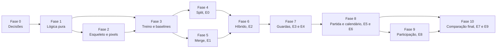

# 10. Roteiro passo a passo

> **Status:** proposta. **Nenhuma fase começou.** A Fase 1 só começa depois da Fase 0 e de um pedido explícito, porque o repositório está em fase de planejamento (D-005 em [decisoes.md](../../decisoes.md)).

## 10.1 Visão geral

Cada fase produz algo testável por si só e pode ser interrompida sem deixar o repositório inconsistente. O tamanho é relativo (P, M, G), porque o custo real de treino ainda não foi medido.

| Fase | Entrega | Tamanho | Precisa de GPU | Experimentos |
|---|---|---|---|---|
| 0 | Decisões registradas | P | Não | — |
| 1 | Lógica pura, com testes | P | Não | C0 |
| 2 | Esqueleto e adaptador de pixels | P | Não | — |
| 3 | Treino federado e baselines simples | M | Sim | — |
| 4 | Operador de split, reproduzindo o CFL | M | Sim | E0 |
| 5 | Operador de merge, reproduzindo o StoCFL | M | Sim | E1 |
| 6 | Híbrido sem guardas | P | Sim | E2 |
| 7 | Guardas e verificação | M | Sim | E3, E4 |
| 8 | Partida e calendário | P | Sim | E5, E6 |
| 9 | Participação parcial | M | Sim | E8 |
| 10 | Comparação final e documentação | G | Sim | E7, E9 |

**Pontos de decisão.** Três fases podem mudar o rumo do projeto:

- **Fase 4 (E0):** `ψ` separa os grupos em dados reais?
- **Fase 6 (E2):** a oscilação do toy acontece em dados reais?
- **Fase 8 (E6):** os primos ficam?

## 10.2 Fases

### Fase 0: decisões

**Objetivo.** Resolver o que bloqueia o início.

1. Revisar as [decisões pendentes](11-decisoes-pendentes.md), ao menos as marcadas como bloqueantes para a Fase 1.
2. Registrar cada uma em [decisoes.md](../../decisoes.md) (política 5).
3. Confirmar a origem da informação de que o CFL é MIT, porque o repositório original não declara licença (DP-17).

**Aceite.** Nenhuma decisão bloqueante em aberto.

**Documentação.** `decisoes.md` e este diretório, marcando cada decisão resolvida.

---

### Fase 1: lógica pura

**Objetivo.** Implementar e testar tudo o que não precisa de treino.

1. Criar `projetos/ISODATA-FL/` com README, `requirements.txt` e os diagramas exigidos pela política 1.
2. `calendario.py`: primos, pares, interprimos, paridade do ISODATA, período fixo, evento, parada do split.
3. `similaridade.py`: `matriz_cos`, normas, `agrupar` ([split](03-split-cfl.md), seção 3.2).
4. `estado.py`: partição, ids, invariantes e histórico.
5. `estabilidade.py`: bloqueios e espera crescente.
6. Portar o [toy](anexo-a-simulacao.md) como teste de regressão usando os módulos reais.

**Aceite.**

- `pytest` passa sem `torch` instalado.
- Calendário: rodadas iguais às de [02](02-calendario.md), sem colisão entre split e merge.
- Propriedade: qualquer sequência de splits e merges preserva as invariantes.
- Toy: mesmos resultados qualitativos do anexo (os valores podem variar um pouco com a reimplementação).

**Interromper se.** O toy com os módulos reais divergir qualitativamente do anexo: há um bug em um dos dois.

**Documentação.** README do subprojeto, tabela de projetos do README da raiz, `projetos/README.md` e créditos.

---

### Fase 2: esqueleto e adaptador de pixels

**Objetivo.** Fazer do ISODATA a base de fato, de forma verificável. Só existe se DP-14 for aprovada.

1. `nucleo.py`: o laço de [08](08-arquitetura-do-codigo.md), seção 8.4.
2. `adaptadores/pixels.py`: operadores de cinza e RGB.
3. `calendario_isodata(K)`: a linha 116 de `ISODATAKit.py` como plugin.
4. Teste de oráculo com `ISODATAKit.py`, sem alterar o arquivo.

**Aceite.** Mesma imagem de saída que `doISODATAGray` e `doISODATARGB`, com a mesma semente, em imagens sintéticas pequenas.

**Documentação.** [Guia técnico do ISODATA](../guia-tecnico-isodata.md), com a referência ao adaptador.

---

### Fase 3: treino federado e baselines simples

**Objetivo.** Ter o laço federado sem operadores, rápido e determinístico.

1. `dados.py`: C1 e C2 primeiro, com tensores em memória e treino, validação e teste por cliente.
2. `treino.py`: treino local sem estado entre rodadas, partindo de um vetor 1-D.
3. `participacao.py`: só M1.
4. `registro.py`: eventos por rodada em JSONL.
5. Baselines: FedAvg e oráculo.
6. **Medir o custo de uma rodada** e estimar o orçamento dos experimentos.

**Aceite.** Mesma semente gera o mesmo resultado; o FedAvg aprende em C1; o oráculo supera o FedAvg em C2.

**Interromper se.** O custo por rodada tornar os experimentos inviáveis: revisar `N` e o tamanho dos cenários em [09](09-experimentos.md).

**Documentação.** README do subprojeto, com como rodar. Seção nova no [guia](../../guia.md).

---

### Fase 4: operador de split

**Objetivo.** Implementar o CFL dentro do esqueleto e **reproduzi-lo** antes de mudar qualquer coisa.

1. `split_cfl.py`: condições 1 a 6, sem `γ_max` e sem persistência.
2. Modo de reprodução: momentum 0,9, decaimento do lr, `len(idc) > 2`, rodada > 20, *complete*.
3. Gerar a referência em um ambiente próprio, com o notebook original corrigido como manda o guia, seção 6 ([08](08-arquitetura-do-codigo.md), P-COD-1), e reproduzi-la.
4. Testar o split de subcluster (bug 3.7 #1).
5. Acrescentar `γ_max` e persistência, atrás de opções.
6. Gravar `ψ` em toda execução e rodar **E0**.

**Aceite.** Em modo de reprodução, a partição é `[0–4]` e `[5–9]`, com acurácia compatível com a do notebook.

**Ponto de decisão (E0).** `ψ` separa os grupos em algum cenário real? Se não, parar e revisar o papel do StoCFL ([09](09-experimentos.md), seção 9.8).

**Documentação.** Guia, com os valores calibrados de `ε` e `γ_max`. Atualizar [03](03-split-cfl.md) com a janela real de `γ_max`.

---

### Fase 5: operador de merge

**Objetivo.** Implementar o agrupamento do StoCFL e reproduzi-lo.

1. `merge_stocfl.py`: `ψ`, centros, pares, `τ`, regra de pares do ISODATA (opcional no modo de reprodução).
2. Modo de reprodução: partida de clientes isolados, centros só com os sorteados e fusões transitivas.
3. Gerar a referência do `StoCFL-FCC+CFL.py` em Rotated MNIST, em ambiente próprio (Python 3.8–3.10 e `fedlab==1.2.1`, guia 4.11), e reproduzir a partição.
4. Rodar **E1**, com todos os baselines.

**Aceite.** No modo de reprodução, a partição final coincide com a do script original, com a mesma sequência de sorteios.

**Documentação.** Guia e [04](04-merge-stocfl.md), com os valores reais de `τ`.

---

### Fase 6: híbrido sem guardas

**Objetivo.** Ligar os operadores e **medir o problema** antes de resolvê-lo.

1. Partida única, split em primos até 70% das rodadas, merge nas pares, `L_FL = 1`, sem verificação.
2. Rodar **E2** em C3 e C4, com `τ` certo e errado.

**Aceite.** O experimento rodou, e as métricas de oscilação foram registradas.

**Ponto de decisão (E2).** Se não houver oscilação com `τ` calibrado, simplificar a pilha na Fase 7.

**Documentação.** [05](05-estabilidade.md), com a evidência real ao lado da do toy.

---

### Fase 7: guardas e verificação

**Objetivo.** Implementar só as guardas que E2 mostrar necessárias.

1. Ganho de fusão. Depois, as verificações alternativas para comparar.
2. Espera crescente, nos dois sentidos.
3. Rodar **E3** (ablação) e **E4** (verificação, `δ`, espera e regra do modelo).

**Aceite.** Em C3 e C4: oscilação limitada pela fórmula de [05](05-estabilidade.md), e partição final no mínimo igual à do melhor baseline.

**Documentação.** [04](04-merge-stocfl.md) e [05](05-estabilidade.md), com a pilha escolhida. Diagramas do subprojeto.

---

### Fase 8: partida e calendário

**Objetivo.** Decidir com dados as duas hipóteses centrais.

1. Partida por `ψ`, caminho de cluster pequeno e reatribuição seletiva.
2. Rodar **E5**.
3. Rodar **E6**. Aqui se decide se a regra dos primos fica.

**Aceite.** DP-01, DP-02 e DP-03 resolvidas com evidência, e registradas em `decisoes.md`.

**Documentação.** [02](02-calendario.md) e [01](01-conceito-e-mapeamento.md), com a decisão.

---

### Fase 9: participação parcial

**Objetivo.** Tirar a exigência de participação total onde der.

1. Média corrigida, indispensável em qualquer modo com amostra.
2. M3 (só amostra), com o estado pendente.
3. M2 (censo), com pré-filtro e espera.
4. Rodar **E8**.
5. Reatribuição completa, só se a seletiva não bastar.

**Aceite.** Com `frac = 0,2` em M2, partição igual à de M1 em C3 (tolerância a definir com base em E1).

**Documentação.** [06](06-clientes-e-participacao.md) e os diagramas.

---

### Fase 10: comparação final

**Objetivo.** Produzir o resultado.

1. Rodar **E7** (modelo global) e, se aprovado, implementar o termo proximal.
2. Rodar **E9**, em todos os cenários e com 5 sementes.
3. Fechar a documentação: guia, READMEs, créditos e diagramas.
4. Marcar os documentos de planejamento como concluídos ou substituídos.

**Aceite.** H1 a H7 têm conclusão registrada, inclusive as refutadas.

## 10.3 Regras para todas as fases

- Consultar a documentação antes de alterar (política 1), incluindo o módulo deste plano relativo ao que será feito.
- Toda mudança de código leva a documentação no mesmo commit (política 2).
- Toda escolha não trivial é perguntada antes (política 4) e registrada (política 5).
- Commits atômicos ao fim de cada tarefa, sem `push` (política 6).
- Resultados de experimento ficam fora do git, exceto as tabelas-resumo na documentação.
