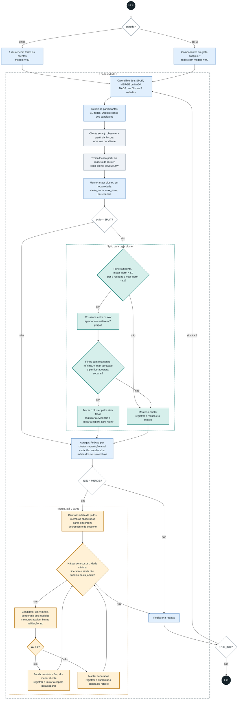
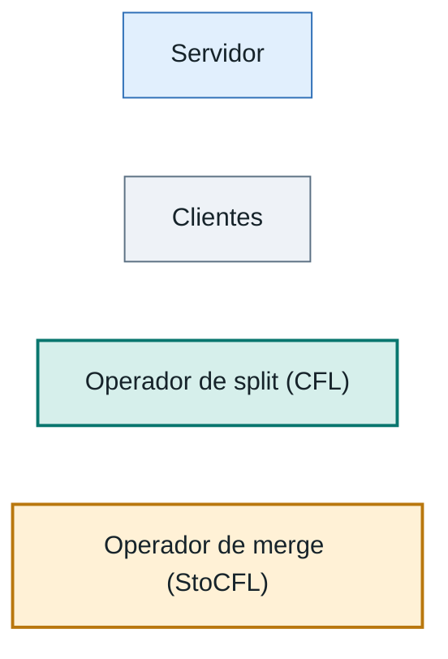
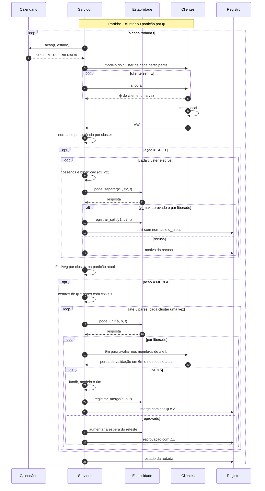
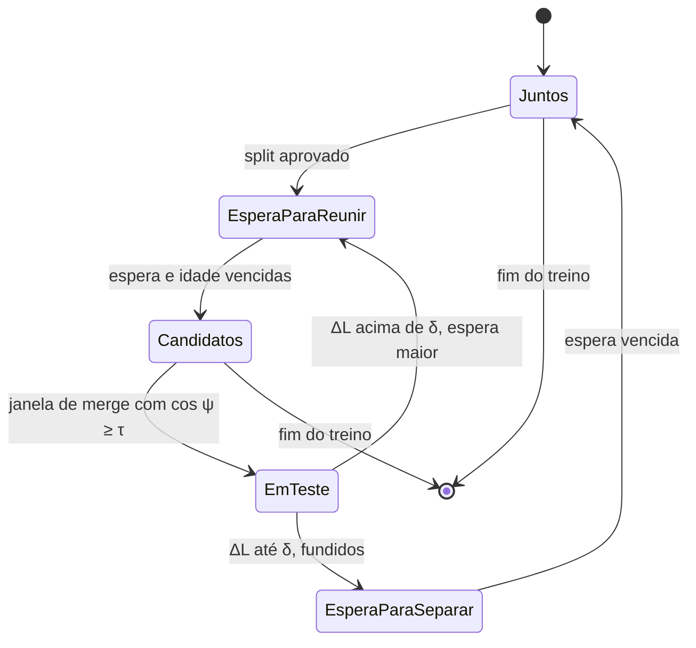
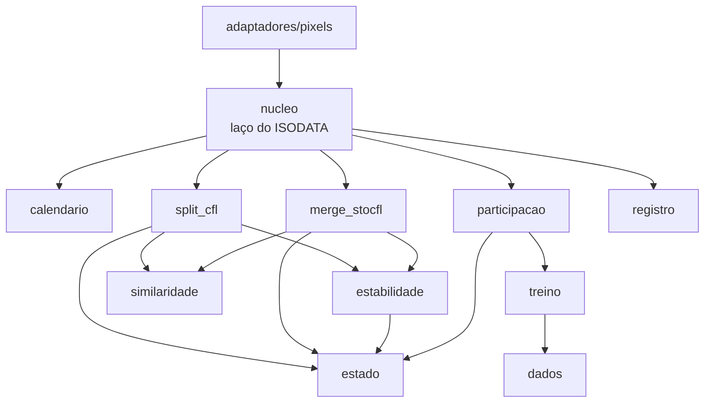

# 12. Diagramas

> **Status:** proposta, nada implementado. Descrevem a configuração recomendada, com partida configurável e participação total. Quando o subprojeto existir, os diagramas de atividades e de sequência passam para `projetos/ISODATA-FL/`, como exige a política 1 do [CLAUDE.md](../../../CLAUDE.md). Substituem, se aprovados, os da [proposta anterior](../diagramas-isodata-fl.md).

## 12.1 Atividades de uma rodada

### Legenda

Os retângulos tracejados são repetições. Losangos são decisões. Para simplificar, o diagrama mostra uma seta entre o split e a agregação, mas o laço do split percorre todos os clusters elegíveis antes de agregar.

## 12.2 Sequência de uma rodada

### Mensagens a mais em relação ao FedAvg

| Mensagem | Quantas vezes | Custo |
|---|---|---|
| `ψ` | Uma por cliente. Gratuita se a rodada 1 for aproveitada | 1 download e 1 upload de modelo |
| Avaliação de `θm` | Só em merges testados, limitados pela espera crescente | 1 download por cliente testado, e 2 números de upload |
| Censo (Fase 9) | Só em clusters candidatos, nas janelas de split | Treino normal, em clientes que não seriam sorteados |

O split não acrescenta nenhuma mensagem: usa os mesmos `ΔW` que o FedAvg já envia.

## 12.3 Estados de um par de grupos de clientes

O que o [módulo de estabilidade](05-estabilidade.md) controla, do ponto de vista de dois grupos que podem estar juntos ou separados:

Cada volta completa no ciclo dobra a espera, o que limita o número de voltas ([05](05-estabilidade.md), seção 5.4).

## 12.4 Como os módulos se ligam

O split e o merge não se conhecem: toda interação entre eles passa por `estabilidade` e `estado`.
