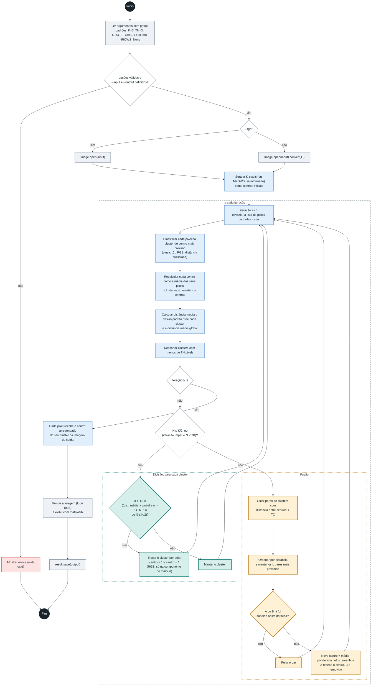
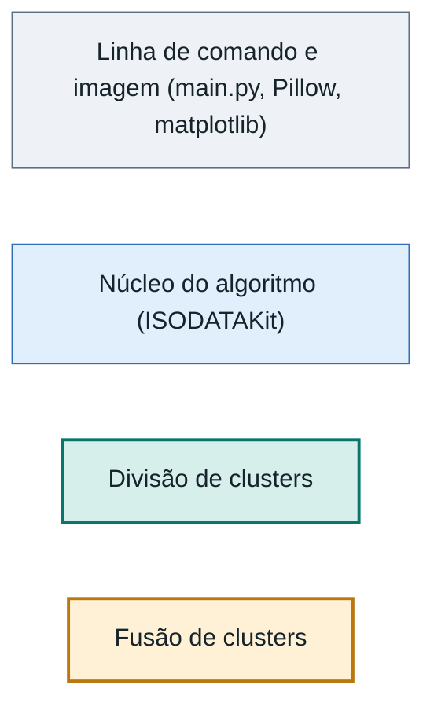

# Diagrama de atividades: ISODATA

Fluxo de `ISODATA-python/`, a partir de `main.py` e de `doISODATAGray` / `doISODATARGB` em `ISODATAKit.py`. O algoritmo classifica os pixels de uma imagem em clusters, dividindo clusters dispersos e fundindo clusters próximos, até atingir o número máximo de iterações `I`.

## Diagrama

### Legenda

Os retângulos tracejados são repetições (UML: região de expansão): o externo é a iteração, e os internos percorrem os clusters (divisão) ou os pares (fusão). Losangos são decisões. A cor indica a etapa, no lugar das raias, porque o Mermaid não desenha raias de verdade.

## Como o fluxo funciona

- **Parâmetros.** `K` é o número de clusters esperado, `TN` o mínimo de pixels por cluster, `TS` o desvio padrão a partir do qual um cluster pode ser dividido, `TC` a distância abaixo da qual dois clusters podem ser fundidos, `L` o máximo de pares fundidos por iteração e `I` o máximo de iterações.
- **Divisão ou fusão, nunca as duas.** Em cada iteração só um dos dois ramos roda. A divisão acontece quando há poucos clusters (N ≤ K/2) ou em iteração ímpar com N < 2K. Caso contrário roda a fusão.
- **Divisão.** O cluster é substituído por dois centros deslocados em ±1. Na imagem RGB o deslocamento é só na componente de maior desvio padrão. Os pixels voltam a ser distribuídos na classificação da iteração seguinte.
- **Fusão.** Só os `L` pares mais próximos com distância menor que `TC` entram. Um cluster que já participou de uma fusão na iteração não é fundido de novo.
- **Parada.** O laço só termina por `iteração ≥ I`, depois do descarte por `TN` e antes da divisão e da fusão. Não há teste de convergência. Os pixels dos clusters descartados nessa última passada ficam com valor 0 na saída.
- **Saída.** Cada pixel vira o centro arredondado do seu cluster. A janela do matplotlib precisa ser fechada antes de o arquivo ser gravado.
