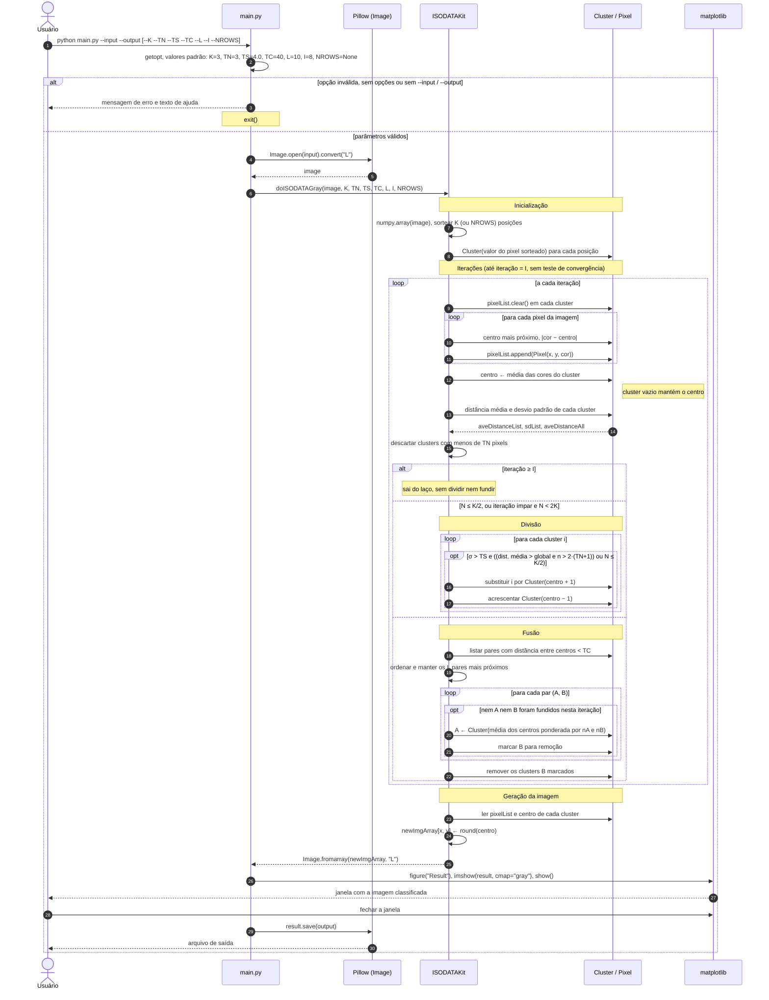

# Diagrama de sequência: ISODATA

Troca de mensagens entre o usuário, `main.py`, o Pillow, o `ISODATAKit.py` e o matplotlib durante uma execução de `python main.py --input ... --output ...`. O diagrama segue o caminho em tons de cinza (`doISODATAGray`), que é o padrão. O caminho RGB (`--rgb`, `doISODATARGB`) tem a mesma ordem de mensagens; as diferenças estão na tabela ao final.

## Diagrama

## Pontos de atenção

- **`show()` antes de `save()`.** `plot.show()` bloqueia até o usuário fechar a janela, e só depois `result.save(outputFilename)` grava o arquivo. Num ambiente sem interface gráfica o arquivo só sai se o backend do matplotlib não bloquear.
- **Parada só por contagem.** O laço termina quando `iterationCount >= I`. Não existe teste de convergência: se os centros se estabilizam na iteração 3, as iterações 4 a 8 ainda rodam.
- **Última iteração.** O `break` vem depois do descarte por `TN` e antes da divisão e da fusão. Os pixels de um cluster descartado nessa última passada não pertencem a nenhum cluster, e na imagem de saída ficam com valor 0.
- **Divisão e fusão alternam.** A divisão só roda com poucos clusters (N ≤ K/2) ou em iteração ímpar com N < 2K. Em iteração par, ou com N ≥ 2K, roda a fusão.
- **Tudo em Python puro.** A classificação percorre cada pixel e cada centro em laços aninhados, por isso o README do projeto avisa que a execução é muito lenta.

## Diferenças do caminho RGB

| Etapa | Tons de cinza (`doISODATAGray`) | RGB (`doISODATARGB`) |
|---|---|---|
| Abertura | `Image.open(input).convert("L")` | `Image.open(input)` |
| Centro | número (float) | vetor `[R, G, B]` |
| Distância | `abs(cor − centro)` | euclidiana nas três componentes |
| Desvio padrão | um valor por cluster | um valor por componente; vale o maior |
| Divisão | `centro + 1` e `centro − 1` | `±1` só na componente de maior desvio |
| Exibição | `imshow(result, cmap="gray")` | `imshow(result)` |
