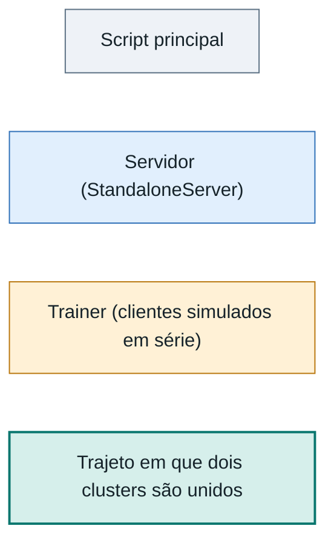

# Diagrama de atividades: StoCFL

Fluxo do experimento de `StoCFL-FCC+CFL.py`, com o servidor `StandaloneServer` e o `RotatedMNISTTrainer` de `trainer.py`. Os três scripts de entrada (`StoCFL-FCC.py`, `StoCFL-FCC+CFL.py`, `StoCFL-FEMNIST.py`) usam o mesmo laço do servidor. A flag `train` separa os dois procedimentos do README:

- `train=0`: só o agrupamento estocástico de clientes (FCC).
- `train=1`: agrupamento mais o treino federado em dois níveis (FCC+CFL).

Ao contrário do CFL do notebook, que parte de um cluster único e divide, aqui cada cliente começa sozinho e os clusters só são unidos.

## Diagrama

```mermaid
flowchart TD
    classDef sc fill:#eef2f7,stroke:#5b7083,color:#16232a
    classDef cl fill:#fff1d6,stroke:#b9770e,color:#16232a
    classDef sv fill:#e1effd,stroke:#2e6fb7,color:#16232a
    classDef mg fill:#d6efeb,stroke:#09766e,stroke-width:2px,color:#16232a
    classDef ctl fill:#ffffff,stroke:#5b7083,color:#16232a
    classDef node0 fill:#16232a,stroke:#16232a,color:#ffffff

    Ini(("Início")):::node0

    %% ---------- Preparação ----------
    P1["Ler argumentos (n, com_round, num_per_round, lr, epochs, mu,<br/>obbs, tau, train, seed, dataset) e chamar setup_seed"]:::sc
    D0{"process == 1?"}:::ctl
    P3["pre_process: rotacionar o dataset e gravar n partições<br/>(MNIST: 0°, 90°, 180°, 270° · CIFAR-10: 0°, 180°)"]:::sc
    P4["Escolher modelo e trainer<br/>mnist: k=4, SimpleLinear · cifar: k=2, CNN_CIFAR10<br/>RotatedMNISTTrainer(model, args)"]:::sc
    P5["Criar a pasta de logs e o Logger, registrar os argumentos"]:::sc
    P6["StandaloneServer: cada cliente em seu próprio cluster<br/>psi = {}, cluster_parameters = {}<br/>gmodel = anchor = modelo inicial"]:::sv

    %% ---------- Rodada ----------
    S1["Sortear num_per_round clientes (ordenados)"]:::sv

    subgraph RO["para cada sorteado que ainda não tem psi"]
        OB1["dataset_representation: gradiente da perda no anchor,<br/>em todo o dataset, sem treinar, e normalizado"]:::cl
        OB2["psi[cid] = gradiente normalizado<br/>(calculado uma única vez por cliente)"]:::sv
    end

    K1["sampled_cluster = clusters atuais dos clientes sorteados"]:::sv
    K2["centro de cada cluster sorteado = média dos psi<br/>de todos os seus membros (Eq. 2)"]:::sv
    Dk{"mais de 1 cluster sorteado?"}:::ctl
    K3["dt_matrix: cosseno entre as direções de cada par de clusters<br/>ordenar os pares do maior cosseno ao menor"]:::sv

    subgraph RP["para cada par de clusters, em ordem decrescente de cosseno"]
        Dtau{"cosseno ≥ tau?"}:::mg
        U1["unite(a, b): juntar os clientes no cluster de menor id<br/>e esvaziar o outro"]:::mg
        U2["cluster_parameters: o modelo do cluster maior prevalece<br/>o do cluster absorvido é removido"]:::mg
        BRK["break: os pares restantes têm cosseno ainda menor"]:::sv
    end

    K4["get_cluster: gravar os clusters no log<br/>e checar que todos os clientes têm cluster"]:::sv
    Dtrain{"train == 1?"}:::ctl

    %% ---------- Treino em dois níveis ----------
    T1["clusters sorteados sem modelo recebem uma cópia de gmodel"]:::sv
    T2["cluster_models = modelo do cluster de cada cliente sorteado"]:::sv

    subgraph RL1["para cada cliente sorteado (modelo do cluster)"]
        L1["train_alone_prox: parte do modelo do cluster<br/>SGD com termo proximal ½·mu·‖w − w_global‖²"]:::cl
    end

    subgraph RL2["para cada cliente sorteado (modelo global)"]
        L2["_train_alone: SGD a partir de gmodel<br/>todos partem do mesmo gmodel da rodada"]:::cl
    end

    T3["gmodel = FedAvg dos modelos gerados no passo anterior"]:::sv

    subgraph RC["para cada cluster sorteado"]
        A1["cluster_parameters[cluster] = FedAvg dos modelos<br/>atualizados dos seus clientes"]:::sv
        A2["avaliar o modelo do cluster no teste da rotação<br/>do primeiro cliente do cluster"]:::sv
        A3["avaliar gmodel no mesmo teste (g_test)"]:::sv
    end

    T5["Registrar as acurácias no log e em accuracy.pkl"]:::sv
    Dend{"há mais rodadas?"}:::ctl
    Fim((("Fim"))):::node0

    Ini --> P1 --> D0
    D0 -->|"sim"| P3 --> P4
    D0 -->|"não"| P4
    P4 --> P5 --> P6 --> S1
    S1 --> OB1 --> OB2 --> K1 --> K2 --> Dk
    Dk -->|"sim"| K3 --> Dtau
    Dk -->|"não"| K4
    Dtau -->|"sim"| U1 --> U2 --> K4
    Dtau -->|"não"| BRK --> K4
    K4 --> Dtrain
    Dtrain -->|"sim"| T1 --> T2 --> L1 --> L2 --> T3 --> A1 --> A2 --> A3 --> T5 --> Dend
    Dtrain -->|"não"| Dend
    Dend -->|"sim, próxima rodada"| S1
    Dend -->|"não"| Fim

    style RO fill:none,stroke:#586a71,stroke-dasharray:6 4
    style RP fill:none,stroke:#586a71,stroke-dasharray:6 4
    style RL1 fill:none,stroke:#586a71,stroke-dasharray:6 4
    style RL2 fill:none,stroke:#586a71,stroke-dasharray:6 4
    style RC fill:none,stroke:#586a71,stroke-dasharray:6 4
```

### Legenda

Os retângulos tracejados são repetições (UML: região de expansão). Losangos são decisões. A cor indica quem executa a atividade, no lugar das raias, porque o Mermaid não desenha raias de verdade.

## Como o fluxo funciona

- **Agrupamento só por união.** Todo cliente começa num cluster próprio (`find_cluster_content[i] = [i]`). `unite` junta clusters e nada no código os divide de volta, então uma união errada não é desfeita.
- **Representação calculada uma vez.** `psi[cid]` é calculado na primeira vez que o cliente é sorteado, como o gradiente normalizado da perda no `anchor` (o modelo inicial), sem treinar, e nunca é refeito. O centro de um cluster é a média dos `psi` de todos os seus membros, e um cluster sorteado nunca tem membro sem `psi`.
- **Uniões em ordem de cosseno.** A matriz de cossenos é calculada uma vez por rodada. Os pares são percorridos do maior cosseno ao menor, e o primeiro par abaixo de `tau` encerra a rodada de uniões. Os cossenos não são recalculados depois de cada união.
- **Dois modelos por cliente.** No treino, cada cliente sorteado atualiza o modelo do seu cluster, com um termo proximal que o mantém perto de `gmodel`, e treina também o modelo global. O servidor faz a média de cada um.
- **Modelo global por FedAvg.** Em `RotatedMNISTTrainer.train`, cada cliente do segundo laço parte do mesmo `gmodel` da rodada, e o servidor faz a média dos modelos resultantes.
- **Teste do cluster.** O teste usa a rotação do primeiro cliente do cluster (`int(cluster_content[0] * k / n)`). Se um cluster misturar rotações, a acurácia dele só reflete uma delas.

## Variações dos scripts

| Script | Dados e modelo | Trainer | Diferenças no laço |
| --- | --- | --- | --- |
| `StoCFL-FCC+CFL.py` | MNIST rotacionado (`SimpleLinear`, k=4) ou CIFAR-10 rotacionado (`CNN_CIFAR10`, k=2) | `RotatedMNISTTrainer` | `train=1` por padrão. Grava `psi.pkl`, `cluster.pkl` e `accuracy.pkl` a cada rodada. |
| `StoCFL-FCC.py` | MNIST em quatro configurações (`--setting`: fskewed, lskewed, shifted, rotated), `SimpleLinear` | Um trainer por configuração | `train=0` por padrão, só agrupamento. Grava o histórico de clusters ao final. Com `train=1`, chama `client_trainer.evaluate`. Entre os trainers de `trainer.py`, só o `ShiftedMNISTTrainer` define esse método, e ele usa `range(id_list)` sobre uma lista. |
| `StoCFL-FEMNIST.py` | FEMNIST (3597 clientes), `CNN_FEMNIST` | `FEMNISTTrainer` | `train=0` por padrão. Mede o modelo global no teste global do FEMNIST e cada cluster no teste dos seus clientes. A medição global roda antes de `gmodel` ser carregado no modelo do servidor, então reflete o `gmodel` da rodada anterior. |
