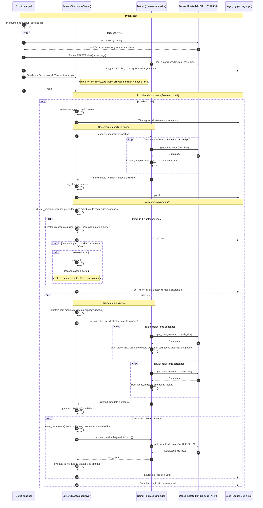

# Diagrama de sequência: StoCFL

Troca de mensagens entre o script principal, o servidor, o trainer, os dados e os logs durante `StoCFL-FCC+CFL.py`. O servidor (`StandaloneServer`) comanda a rodada. O trainer (`RotatedMNISTTrainer`, um `SerialTrainer` do FedLab) representa todos os clientes e treina um de cada vez no mesmo processo. A flag `train` separa só o agrupamento (`train=0`) do treino em dois níveis (`train=1`). As variações entre os scripts estão na tabela de `diagrama-atividades-stocfl.md`.

## Diagrama

## Pontos de atenção

- **Trainer único.** Os clientes não existem como objetos. O servidor chama o trainer com uma lista de ids, e o trainer carrega os dados de cada cliente do disco quando precisa. Num sistema distribuído, as setas `observe` e `train` seriam mensagens de rede.
- **`observe` é chamado sempre.** Quando todos os sorteados já têm `psi`, a lista `unobserved` é vazia e nenhum cliente treina. Por isso o laço de observação fica vazio nas rodadas em que não aparece nenhum cliente novo.
- **Cosseno entre clusters, não entre clientes.** A matriz usa o centro de cada cluster sorteado, a média dos `psi` de todos os seus membros. Só clusters sorteados na rodada são comparados.
- **Dois laços de treino separados.** No `train`, todos os clientes treinam primeiro o modelo do cluster, e só depois o modelo global. Nos dois laços, cada cliente parte do modelo enviado pelo servidor naquela rodada.
- **Arquivos reescritos.** `cos_rec.log` e `cluster_rec.log` são apagados e recriados a cada rodada, então o disco guarda só o estado da última. O histórico completo dos clusters fica em `cluster.pkl`.
