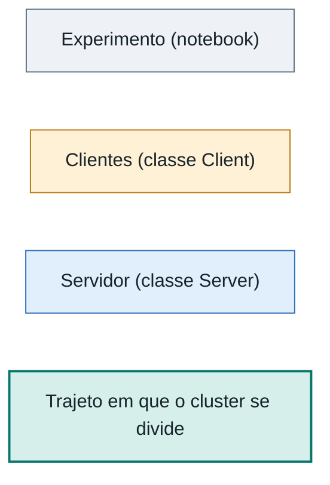

# Diagrama de atividades: Clustered Federated Learning

Fluxo do experimento de `clustered-federated-learning/`, a partir de `clustered_federated_learning.ipynb` e das classes `Client` e `Server` de `fl_devices.py`. O cenário usa 10 clientes com dados EMNIST não-IID (Dirichlet, α=1.0), 80 rodadas de comunicação e divisão de clusters decidida pelas normas das atualizações.

## Diagrama

```mermaid
flowchart TD
    classDef nb fill:#eef2f7,stroke:#5b7083,color:#16232a
    classDef cl fill:#fff1d6,stroke:#b9770e,color:#16232a
    classDef sv fill:#e1effd,stroke:#2e6fb7,color:#16232a
    classDef split fill:#d6efeb,stroke:#09766e,stroke-width:2px,color:#16232a
    classDef ctl fill:#ffffff,stroke:#5b7083,color:#16232a
    classDef node0 fill:#16232a,stroke:#16232a,color:#ffffff

    Ini(("Início")):::node0

    %% ---------- Preparação ----------
    A1["Carregar EMNIST (byclass)<br/>sortear 10 mil índices de treino e 10 mil de teste"]:::nb
    A2["split_noniid: distribui o treino entre 10 clientes<br/>(Dirichlet, α=1.0)"]:::nb
    A3["Rotacionar 180° os dados dos clientes 0–4<br/>(induz dois grupos)"]:::nb
    A4["Criar 10 Client (ConvNet, SGD lr=0.1, momentum=0.9)<br/>cada um com split 80% treino / 20% avaliação"]:::cl
    A5["Criar Server (ConvNet)<br/>com o conjunto de teste"]:::sv
    A6["cluster_indices = [todos os clientes]<br/>ε₁=0.4, ε₂=1.6, 80 rodadas<br/>criar ExperimentLogger"]:::nb

    %% ---------- Rodada de comunicação ----------
    D1{"c_round == 1?"}:::ctl
    B2["synchronize_with_server<br/>W ← pesos do servidor"]:::cl
    B3["select_clients(frac=1.0)<br/>define os clientes participantes"]:::sv

    subgraph R1["para cada cliente participante"]
        I1["W_old ← W; lr ← lr·0.99"]:::cl
        I2["train_op: 1 época de SGD"]:::cl
        I3["dW ← W − W_old"]:::cl
        I4["reset: W ← W_old"]:::cl
    end

    B5["compute_pairwise_similarities<br/>cosseno entre os dW → matriz S"]:::sv

    subgraph R2["para cada cluster idc"]
        E1["calcular max_norm e mean_norm<br/>dos dW dos clientes do cluster"]:::sv
        D2{"mean_norm #lt; ε₁ ∧ max_norm #gt; ε₂<br/>∧ len(idc) #gt; 1?"}:::split
        S2["cluster_clients<br/>Algoritmo 1 do artigo sobre S → c1, c2"]:::split
        S4["alpha_cross_max: maior cosseno<br/>entre os dois lados"]:::split
        D4{"γ_max #lt; √((1 − alpha_cross_max) / 2)?"}:::split
        S1["cache_model<br/>guarda o modelo do cluster pai e acc_clients"]:::split
        S3["novos clusters: idc[c1] e idc[c2]<br/>registrar o split no cfl_stats"]:::split
        N1["manter idc sem divisão<br/>cluster_indices_new += [idc]"]:::sv
    end

    B7["atualizar cluster_indices e client_clusters"]:::sv
    B8["aggregate_clusterwise<br/>em cada cliente: W += média dos dW do seu cluster"]:::sv
    B9["evaluate<br/>acurácia no eval_loader → acc_clients"]:::cl
    B10["Registrar acurácias, normas e clusters no ExperimentLogger<br/>display_train_stats"]:::nb
    D3{"c_round #lt; 80?"}:::ctl

    %% ---------- Pós-treino ----------
    C1["cache_model de cada cluster final<br/>(modelo + acurácias)"]:::sv
    C2["Montar a matriz de resultados:<br/>acurácia de cada cliente em cada modelo de model_cache"]:::nb
    C3["Para cada cliente, destacar o modelo<br/>de maior acurácia (FL base ou de cluster)"]:::nb
    Fim((("Fim"))):::node0

    Ini --> A1 --> A2 --> A3 --> A4 --> A5 --> A6 --> D1
    D1 -->|"sim"| B2 --> B3
    D1 -->|"não"| B3
    B3 --> I1 --> I2 --> I3 --> I4 --> B5 --> E1 --> D2
    D2 -->|"sim"| S2 --> S4 --> D4
    D4 -->|"sim"| S1 --> S3 --> B7
    D4 -->|"não"| N1
    D2 -->|"não"| N1 --> B7
    B7 --> B8 --> B9 --> B10 --> D3
    D3 -->|"sim: c_round += 1"| D1
    D3 -->|"não"| C1 --> C2 --> C3 --> Fim

    style R1 fill:none,stroke:#586a71,stroke-dasharray:6 4
    style R2 fill:none,stroke:#586a71,stroke-dasharray:6 4
```

### Legenda

Os retângulos tracejados são repetições (UML: região de expansão). Losangos são decisões. A cor indica quem executa a atividade, no lugar das raias, porque o Mermaid não desenha raias de verdade.

## Como o fluxo funciona

- **Atualização sem aplicar.** Cada cliente treina uma época e volta ao modelo anterior (`reset`). Só `dW` fica guardado e é usado depois na agregação.
- **Quando o cluster se divide.** O critério é o do Algoritmo 5 do artigo. A bipartição só é calculada se `mean_norm < ε₁` (a média das atualizações quase se anula) e `max_norm > ε₂` (cada atualização ainda é grande), o que indica clientes puxando o modelo em direções opostas. Ela só é aceita se `γ_max < √((1 − alpha_cross_max) / 2)`. Se for rejeitada, o cluster fica como está, e o teste se repete na rodada seguinte.
- **Agregação por cluster.** O notebook não chama `Server.aggregate_weight_updates`. O servidor só entrega os pesos iniciais na rodada 1; depois, `aggregate_clusterwise` soma a média dos `dW` de cada cluster diretamente nos `W` dos clientes.
- **Modelos guardados.** `cache_model` roda a cada divisão aceita (guarda o modelo do cluster pai) e no fim para cada cluster final. A tabela final compara esses modelos por cliente.
