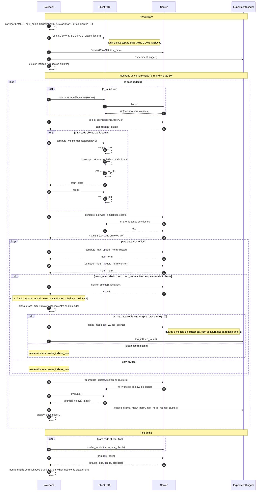

# Diagrama de sequência: Clustered Federated Learning

Troca de mensagens entre o notebook, os clientes, o servidor e o logger durante o experimento de `clustered_federated_learning.ipynb`, com as classes `Client` e `Server` de `fl_devices.py` e o `ExperimentLogger` de `helper.py`. O notebook é quem orquestra: clientes e servidor não chamam um ao outro, só são chamados por ele ou lidos por ele.

## Diagrama

## Pontos de atenção

- **Servidor lê o cliente direto.** Em `compute_pairwise_similarities`, nas normas e em `aggregate_clusterwise`, o servidor acessa `client.dW` e `client.W` como atributos. É uma simulação em um só processo. Num sistema distribuído, essas setas seriam mensagens de rede.
- **Servidor quase não participa.** O único uso dos pesos do `Server` é a sincronização da rodada 1. Depois disso, o modelo de cada cliente evolui só pela agregação dentro do seu cluster.
- **`reset()` depois do treino.** O cliente volta a `W_old` logo após calcular `dW`. O ganho de treino só reaparece em `W` quando o servidor soma a média dos `dW` do cluster.
- **Normas por cluster.** `max_norm` e `mean_norm` são calculadas para cada `idc`, mas o `log` guarda só os valores do último cluster percorrido na rodada.
